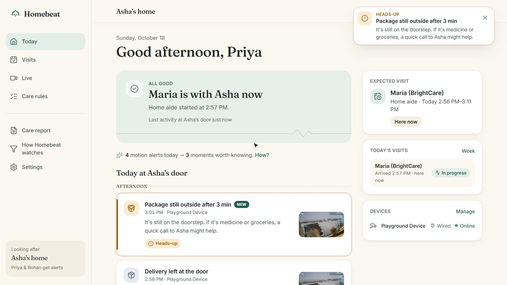
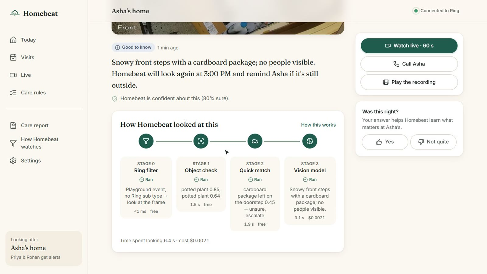
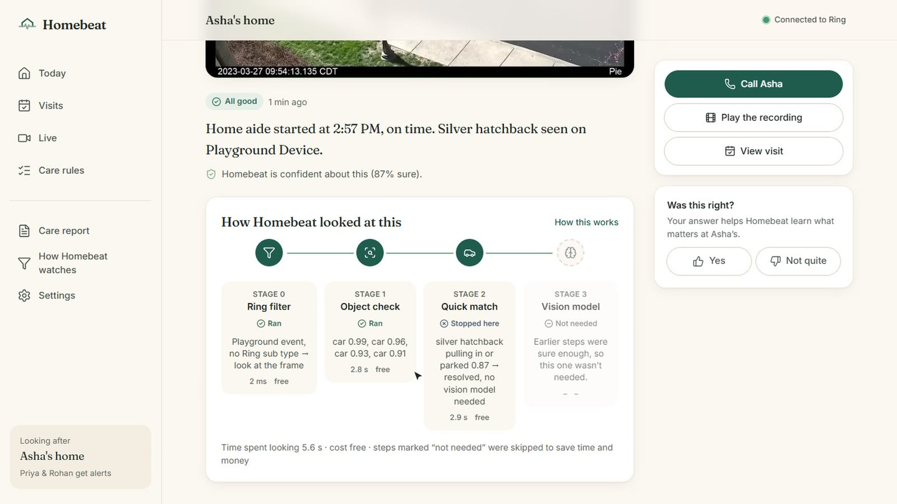
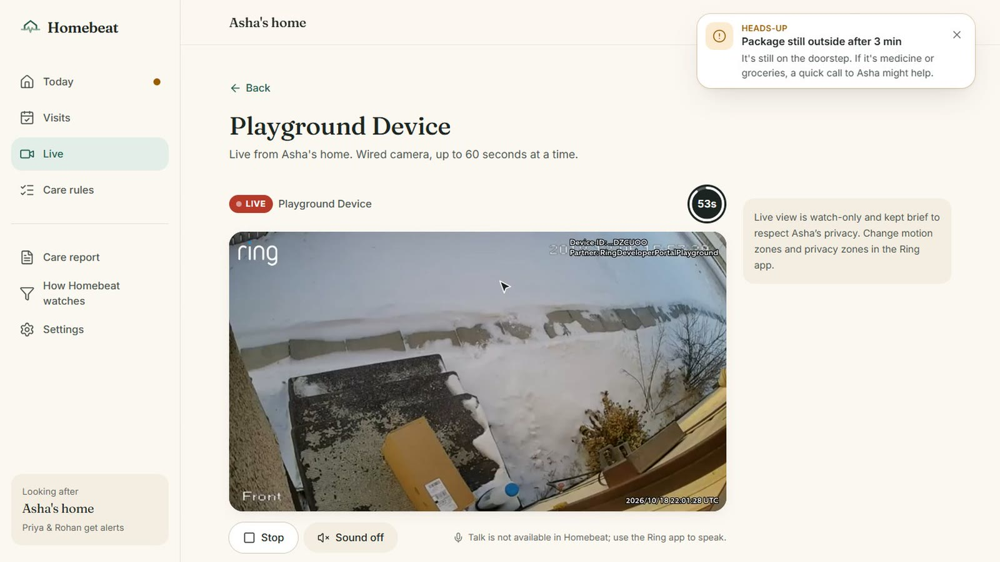
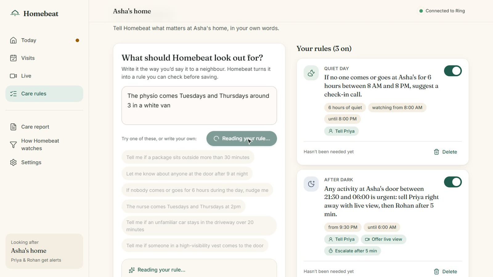
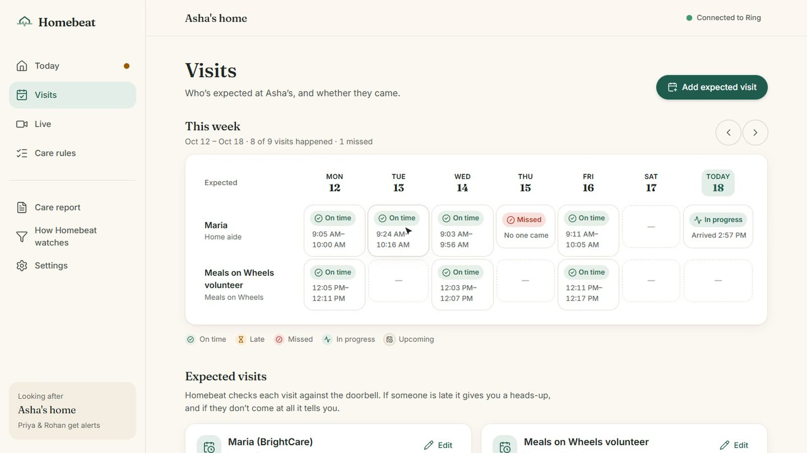
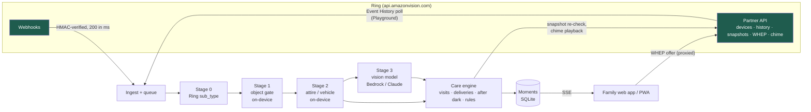

# Homebeat

**Know Mom's okay, from her front door.**

Homebeat is a Ring Appstore app for families of an older parent who lives alone. It reads the parent's Ring
doorbell and cameras and turns raw motion ("Motion at Front Door", forty times a day) into a few calm moments
that matter to a family: *the aide arrived at 9:04 and stayed 54 minutes*, *the pharmacy delivery is still
outside after 30 minutes*, *someone was at the door at 10:41 PM*. It never uses face recognition.

Built for the **Ring track** of *Build, Ship, Shape: Amazon Developer Hackathon* (October 2026).
Priority categories: **caretaking**, **access control**, **accessibility**.

> Demo video: _link added at submission_ · Ring integration details: [docs/RING_INTEGRATION.md](docs/RING_INTEGRATION.md) ·
> Friction log: [docs/FRICTION_LOG.md](docs/FRICTION_LOG.md) · Product feedback: [docs/FEEDBACK.md](docs/FEEDBACK.md)

---

## The problem

63 million Americans are family caregivers ([AARP, Caregiving in the U.S. 2025](https://www.aarp.org/pri/topics/ltss/family-caregiving/caregiving-in-the-us-2025/)),
and 16.2 million older Americans live alone ([ACL, 2023 Profile of Older Americans](https://acl.gov/sites/default/files/Profile%20of%20OA/ACL_ProfileOlderAmericans2023_508.pdf)).
Many of those parents already have a Ring doorbell at the one place where their day touches the outside world.

But a doorbell built for security speaks in motion alerts. The adult child who set it up mutes them within a
week, and then the things they actually worry about go unnoticed:

- **Did the home aide actually come?** Families pay for visits they can't see. Medicaid already requires
  electronic visit verification for home care (21st Century Cures Act, §12006); private-pay families get nothing.
- **Is a delivery sitting outside?** Medication and groceries left on the step, unnoticed for hours.
- **Who's at the door at night?** The one alert that should never be muted.
- **Is today unusually quiet?** No one in or out all day is worth a phone call.

## What Homebeat does

| | |
|---|---|
| **Visit verification** | Expected visits (aide, nurse, meals) with arrival windows. Homebeat confirms arrival and departure from Ring events, flags *late* and *missed*, and adds evidence: Ring motion, doorbell press, the aide's car, and a one-tap check-in link on the aide's own phone (two signals, no biometrics). |
| **Deliveries that matter** | When a package is left, Homebeat re-checks the doorstep later with a Ring snapshot. Still there? It plays a soft tone on the parent's Ring Chime and tells the family. |
| **After dark** | Anyone at the door during quiet hours is urgent: snapshot, one-tap Ring live view, and escalation to a sibling if the first person doesn't respond. |
| **Quiet days** | No one in or out for hours during the day → "Might be a good moment to give Asha a call." |
| **Plain-English rules** | "Tell me if a package sits outside more than 30 minutes", "The physio comes Tuesdays and Thursdays around 3 in a white van". A model translates the sentence into one of six structured rule types; the family checks the card before saving; rules run deterministically. |
| **Daily digest and weekly care report** | One calm paragraph a day instead of forty alerts, and a printable weekly report (visits on time / late / missed, hours of care) to share with siblings or the care agency. |

## Screens

Captured during a live run against the Ring Developer Playground (real Ring events, frames and stream; the
family is a sample persona).

| | |
|---|---|
|  |  |
| **Today.** Ring alerts in, a few moments out; a heads-up when a package sits outside. | **Every moment explains itself.** The Playground's package clip went through all four stages for $0.0021. |
|  |  |
| **Arrival from the aide's car,** matched on the free on-device step. | **Live view** over Ring's WHEP API, stopping at the device's limit; Ring's watermark stays uncovered. |
|  |  |
| **Plain-English rules** the family reads before saving. | **Visits** checked against the schedule, with a one-tap check-in link for the aide. |

## Built on Ring, the way Ring's own guides describe

- **Ring Partner API end to end:** device discovery with `include`, status/capabilities/configurations, Event
  History with composite sub-type filters, image snapshots (303 flow, 416 backoff), clips, WHEP live view
  proxied server-side with the 30 s / 60 s session limit enforced, chime audio playback, Users API, OAuth
  token exchange and refresh, one-way account linking (HMAC nonce + app-integrations POST/PATCH), and HMAC-verified
  webhooks answered in milliseconds with `request_id` de-duplication. Full map: [docs/RING_INTEGRATION.md](docs/RING_INTEGRATION.md).
- **Ring's Computer Vision Guidelines as running code:** a four-stage funnel (Ring `sub_type` → on-device
  object gate → on-device attire/vehicle match → vision model) so cost follows *events that matter*, not raw
  motion. Every moment shows its own trace (stage, milliseconds, cost), and the app shows the month's totals.
  On real frames from the Ring Developer Playground (`npx tsx scripts/eval.ts`), the funnel was right on 6 of
  6 with one vision-model call, the same accuracy as sending every frame to the model at one sixth of the cost.
  Across all 17 labelled frames (those plus the offline simulator's scenes) it was right on 17 with 10 calls;
  sending every frame to the same model got 12 right with 17 calls ([results](server/eval/results.json)).
- **Tested against the live Ring API**, not only a mock: the Playground's Package, Vehicle and Motion clips run
  through Homebeat as real events, frames, clips and a WHEP stream. What that turned up (16 entries, with
  workarounds) is in [docs/FRICTION_LOG.md](docs/FRICTION_LOG.md).
- **Ring's UX design guide:** passwordless account linking, a confirmation screen with each device's online
  status, a skippable first-visit tour, "Ring app" guidance for Smart Alerts and motion zones, graceful handling
  of end-to-end-encrypted devices, WCAG 2.2 AA.

## Architecture



- `server/`: Node 22+ / TypeScript / Fastify, SQLite via the built-in `node:sqlite`, on-device models via
  transformers.js (ONNX), vision/text model via Amazon Bedrock, the Anthropic API or any OpenAI-compatible endpoint.
- `web/`: React + Vite + Tailwind PWA, mobile first.
- `shared/types.ts`: the API contract both sides compile against.

## Run it

Requires Node.js 22.13+.

```bash
npm run setup          # installs server/ and web/
cp .env.example .env   # optional: AI provider, Ring credentials
npm start              # builds the web app and serves everything on http://localhost:8787
```

Homebeat has three Ring modes, shown in the header and in Settings:

1. **Ring Developer Playground** (no Ring device needed): open
   [the Playground](https://developer.amazon.com/ring/console/playground), click *Generate Token*, and paste it
   in Homebeat → Settings → Ring connection (or set `RING_ACCESS_TOKEN`). Homebeat discovers the Playground
   Device and polls its Event History. Under *Simulate live view event*, click Package, Vehicle or Motion: when
   the clip ends, Homebeat reads the event, pulls frames through the image API and runs the funnel. Tested
   against the live API: Vehicle → "Maria arrived, on time" (the aide's car matched on-device, free); Package →
   "Delivery left at the door"; Motion (birds at a feeder) → dropped on-device, never shown. *Live* streams the
   Playground Device over WHEP. Tokens last 30 minutes; the Playground's simulated events are live views with no
   `sub_type`, so Homebeat classifies them itself ([friction log #11](docs/FRICTION_LOG.md)).
2. **Linked Ring Appstore app:** set `RING_CLIENT_ID`, `RING_CLIENT_SECRET`, `RING_HMAC_KEY` and register
   `/ring/token-exchange`, `/ring/link` and `/ring/webhook` as the app's URLs. (`RING_REFRESH_TOKEN` skips linking.)
3. **Offline simulator** (no Ring account): used automatically when neither is configured, and labelled as such.
   Settings shows buttons for the aide arriving, a delivery, an after-dark visitor and more.

The vision model is configured with `AI_PROVIDER` (`bedrock`, `anthropic`, `openai`, or `none`; see
`.env.example`). With `none`, Homebeat still works from Ring's own classification and the on-device stages.

`DEMO=1` adds `POST /api/demo/reset`, which re-seeds the sample week and opens today's aide window two minutes
from now, so the whole arrival → visit → departure story can be shown live.

## Privacy

- No face recognition, no face database, no identity guesses. Visitors are described by what they wear and
  carry ("a care worker in scrubs with a bag") and confirmed by schedule, car and check-in link.
- Snapshots are kept only for moments and analyses, served only to the household.
- The parent's consent is recorded and shown in Settings; the parent can pause Homebeat.
- Seeded example history is marked `sample` in the data and labelled "Sample" in the app. Live Ring events
  never are.

## Tests

```bash
npm test               # webhook signatures, nonce encoding, device normalization, rules, time windows
npm run typecheck
```

## What was built during the hackathon

Everything in this repository was written between October 19 and October 23, 2026.

## License

[MIT](LICENSE)

`server/eval/frames/playground_*.jpg` are frames from the Ring Developer Playground's sample clips, as returned
by the Ring image API (with Ring's watermark). The package clip is "Thief stealing our package" by YouTube user
[frollard](https://www.youtube.com/@frollard), used under [CC BY 4.0](https://creativecommons.org/licenses/by/4.0/)
and clipped by Ring; the vehicle and motion clips are the Playground's other samples. They are not covered by
the MIT license.
